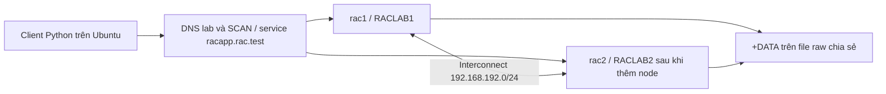

# RAC - LAB : FINAL PROJECT

Lab chạy Oracle Grid Infrastructure, ASM và Oracle Database 19c Enterprise Edition trong hai VM Oracle Linux 7.9 trên một host Ubuntu. Hai VM dùng 4 vCPU, 9 GiB RAM cấu hình cố định và 80 GiB đĩa hệ điều hành QCOW2 cấp phát động. Một file raw 60 GiB phục vụ ASM với external redundancy. Thử nghiệm cắt nguồn kiểm tra khả năng phục hồi khi mất một VM. Host và đĩa ASM là điểm lỗi chung của lab.



| Thành phần | Giá trị |
| --- | --- |
| Mạng client NAT, bridge trên host | `192.168.191.0/24`, `virbr-racpub`, gateway và DNS `192.168.191.1` |
| Mạng interconnect lớp 2, bridge trên host | `192.168.192.0/24`, `virbr-racpriv`, guest không có gateway trên interface này |
| rac1 | public `.191.11`, private `.192.11`, VIP `.191.21` |
| rac2 | public `.191.12`, private `.192.12`, VIP `.191.22` |
| SCAN | `rac-scan.rac.test`, `192.168.191.31` đến `.33` |
| Database, PDB và application service | `RACLAB`, `APPPDB`, `racapp.rac.test:1521` |
| Thiết bị ASM trong guest | `/dev/rac-asm01`, serial `RAC_ASM01`, file `/var/lib/libvirt/images/rac-lab/rac-asm.raw` |

Xem [báo cáo đồ án](BAO-CAO.md) để đọc kết quả triển khai, thử cắt nguồn và tái gia nhập cụm.

## Báo cáo benchmark

So sánh service RAC phục vụ trên một và hai instance. Cả hai VM hoạt động trong suốt phép đo. Mỗi lượt dùng **12 worker**, **60 giây warm-up** và **180 giây đo**. Hai cấu hình dùng cùng mẫu payload và bảng thử được làm trống trước mỗi lượt.

| Cấu hình service | Lượt hợp lệ | Instance thực tế phục vụ |
| --- | --- | --- |
| Một instance | 3/3 | `RACLAB1` trong cả ba lượt |
| Hai instance | 3/3 | `RACLAB1` và `RACLAB2` trong cả ba lượt |

Client ghi nhận TPS, p50/p95, tỷ lệ request gặp lỗi và phân bố giao dịch theo instance. Host ghi RAM, swap và I/O trong mỗi lượt. Sau **6/6 lượt hợp lệ**, service chạy lại trên cả hai instance và client commit thành công qua SCAN.

Xem thêm [phương pháp đo và tiêu chí xác minh](BAO-CAO.md#phương-pháp-đo). Số đo và biểu đồ hiệu năng lưu trong báo cáo nội bộ theo [điều khoản OTN Developer của Oracle](https://www.oracle.com/downloads/licenses/standard-license.html).

## Kiểm tra và dựng lại

Chạy từ thư mục repo bằng tài khoản thường có nhóm `kvm` và `libvirt`. Nếu tài khoản đã có nhóm nhưng phiên Xfce hiện tại chưa nhận, đăng xuất hẳn Xfce, đăng nhập lại và mở workspace. Trong phiên cũ có thể dùng `sg kvm -c 'sg libvirt -c ./scripts/host-check.sh'`. Nạp nhóm theo cách này chỉ áp dụng cho tiến trình con.

```bash
./scripts/host-check.sh
python3 -m venv .venv
.venv/bin/python -m pip install -r client/requirements.txt
./scripts/fetch-ol79.sh
(cd media; sha256sum -c ../infra/media.sha256)
./scripts/install-guests.sh
./scripts/prepare-guests.sh
./scripts/stage-oracle.sh
./scripts/install-grid.sh
./scripts/install-db.sh
./scripts/run-demos.sh
./scripts/benchmark-suite.sh
```

Đặt các ZIP chính thức `LINUX.X64_193000_grid_home.zip` và `LINUX.X64_193000_db_home.zip` trong `media/` sau khi duyệt điều khoản Oracle. Tải ISO từ Oracle Linux Yum Server. Mốc cài phần mềm chỉ chạy sau khi SHA-256 khớp. Các lệnh dài có thể chạy trong `tmux` và log nằm ở `evidence/`. [Oracle Database 19c Linux x86-64](https://www.oracle.com/database/technologies/oracle19c-linux-downloads.html) · [SHA-256 chính thức của Oracle Linux 7.9](https://linux.oracle.com/security/gpg/checksum/OracleLinux-R7-U9-Server-x86_64.checksum)

```bash
tmux new-session -d -s rac-lab-install './scripts/install-grid.sh && ./scripts/install-db.sh'
tmux list-sessions
tail -f evidence/install-grid.log
```

Script cài Oracle kiểm tra điều kiện và chạy theo từng pha. Nếu OUI hay root script dừng giữa chừng, đọc log pha đó và kiểm tra trạng thái inventory, Clusterware và ASM trước khi chạy tiếp. Dữ liệu, khóa, response file đã điền và kết quả benchmark được giữ ở thư mục ngoài phạm vi theo dõi của Git.

## Vận hành

```bash
./scripts/infra-prepare.sh
./scripts/vmctl.sh start rac1
./scripts/vmctl.sh start rac2
./scripts/cluster-status.sh rac1
./scripts/guest-ssh.sh rac2 'hostname -f; chronyc tracking'
dig @192.168.191.1 rac-scan.rac.test A +short
```

Dừng workload trước khi tắt lab. Sau đó dừng database có kiểm soát từ guest, tắt từng VM và kiểm tra trạng thái. Kết nối quản trị Ubuntu qua SSH/xrdp hoạt động độc lập.

```bash
./scripts/guest-ssh.sh rac1 'sudo -iu oracle env ORACLE_HOME=/u01/app/oracle/product/19c/dbhome_1 /u01/app/oracle/product/19c/dbhome_1/bin/srvctl stop database -db RACLAB -stopoption IMMEDIATE'
./scripts/vmctl.sh shutdown rac1
./scripts/vmctl.sh shutdown rac2
./scripts/vmctl.sh state rac1
./scripts/vmctl.sh state rac2
```

## Bản sao trước khi thêm node

Chạy `./scripts/backup-single-node.sh` khi cluster mới có `rac1` và client đã commit. Script dừng database, Clusterware và cả hai guest, sau đó chép hai đĩa hệ điều hành, file ASM, XML mạng và hai VM. `state/single-node-backup` trỏ đến thư mục bản sao. Kiểm tra `sha256sum -c SHA256SUMS` từ thư mục đó trước khi dùng. Bộ ba đĩa phải được phục hồi cùng nhau trong một phiên lab đã dừng.

## Sự cố đã xử lý

- `/dev/kvm` và socket libvirt trả lỗi quyền vì VS Code được mở từ phiên đăng nhập cũ. Nạp các nhóm đã có với `sg` cho lần chạy thử. QMP trả `enabled=true` và `present=true`. `virt-host-validate` còn cảnh báo cgroup devices, IOMMU passthrough và secure guest. Libvirt đã chạy được cả hai VM dùng KVM.
- Lệnh `virsh pool-list --name` thêm khoảng trắng sau tên pool. Script chuẩn hóa đầu ra để dùng lại pool đang chạy.
- Sau Kickstart, `virt-install --noautoconsole` để VM tắt khi trình cài kết thúc. Script chờ trạng thái shutdown rồi chạy VM từ đĩa hệ điều hành.
- `lsblk` của Oracle Linux 7 có thể để trống cột serial của đĩa virtio. Script đọc `/sys/class/block/vdb/serial`, kiểm tra đường dẫn by-id, kích thước, thiết bị mount ở `/` và XML libvirt.
- CVU báo `PRVG-10467` trước khi có inventory. Lệnh trước cài đặt chỉ định tường minh nhóm `oinstall` và các nhóm ASM.
- CVU báo `PRVF-5636` vì DNS treo khi hỏi tên ngắn không tồn tại. `forwardPlainNames="no"` trên mạng lab trả NXDOMAIN ngay. Giữ nguyên tên DNS ở SCAN và các VIP.
- CVU báo `PRVG-11138` và `PRVG-11352` khi zone private bị NetworkManager đưa về `public` sau reboot. Lưu `connection.zone=trusted` ở connection interconnect, cho phép UDP multicast kiểm tra Oracle theo địa chỉ đích trên subnet client rồi chạy lại CVU.

- CVU trước khi thêm node cần kết nối TCP giữa các địa chỉ public của hai node và VIP/SCAN. Ngoại lệ firewalld có giới hạn địa chỉ và thời gian, rồi được rút khi script thêm node kết thúc. CVU vẫn cảnh báo UUID nhãn đĩa virtio whole-disk. Hai guest có cùng SHA-256 của header ASM và trỏ cùng file trên host.
- DBCA silent trên bản 19.3 hỏi mật khẩu DBSNMP khi response file thiếu trường này. Thêm mật khẩu riêng vào response file rồi chạy lại pha DBCA.

- Gọi `crsctl` bằng root trên rac2 trước root script có thể tạo thư mục chẩn đoán do root sở hữu. Trong lần triển khai này, việc đó làm OUI báo `INS-32250`. Tôi trả quyền thư mục cho `grid:oinstall` và chuyển Grid Home cùng inventory cài dở trên rac2 sang thư mục khôi phục trước khi chạy lại.

- Khi chạy các kết nối ngắn nối tiếp, SCAN với mục tiêu cân bằng `LONG` từng trả mọi kết nối về rac2 trong một lượt probe. Để kiểm chứng đọc chéo và xác định đúng phiên trước khi cắt nguồn, client chọn `INSTANCE_NAME` qua cùng service và đọc lại danh tính instance. Khi thử kết nối lại sau lỗi, client dùng service và để SCAN chọn instance.
